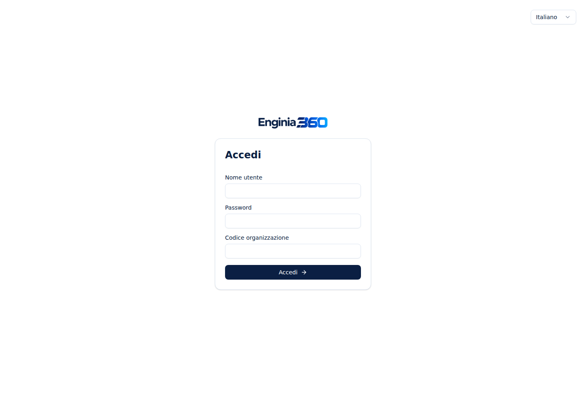
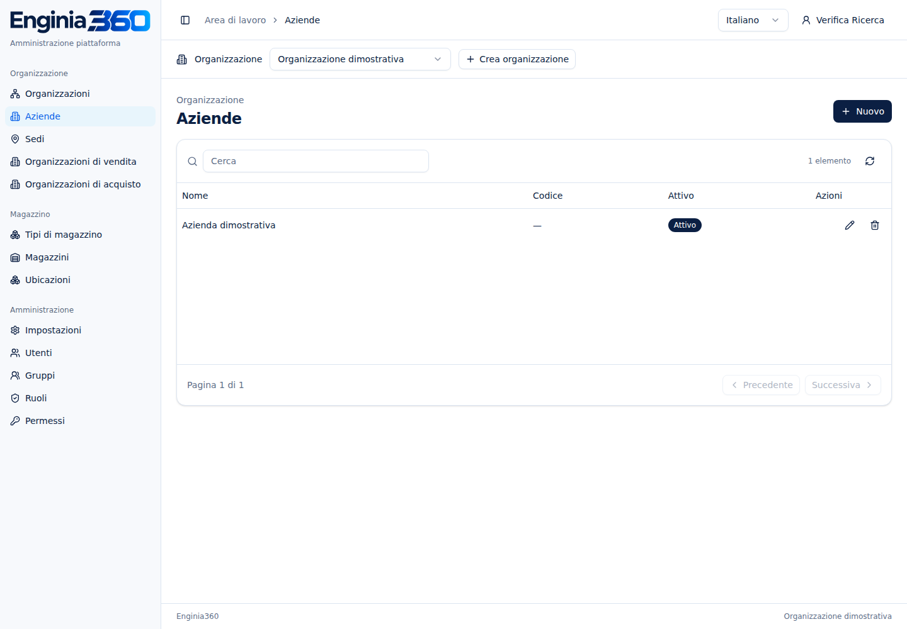
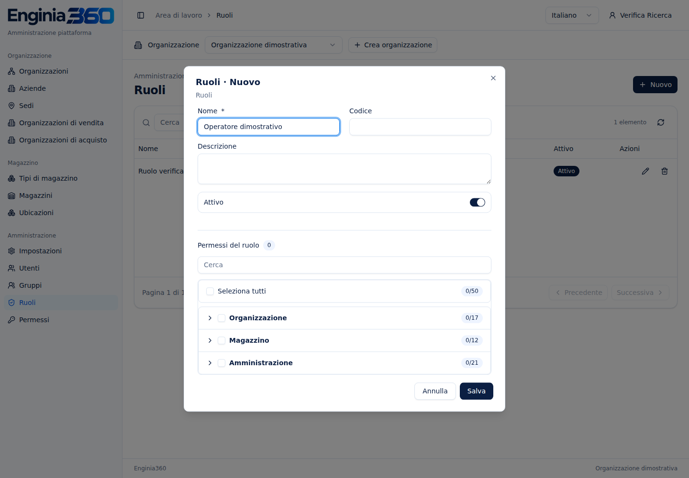
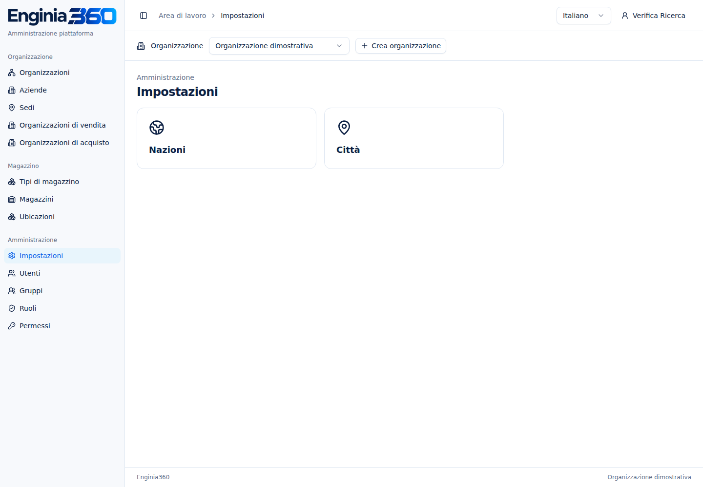

# Enginia360 — Guida rapida

Questa guida spiega accesso, anagrafiche, Business Partner e rapporti aziendali, magazzini, utenti, autorizzazioni e cataloghi geografici.

Le schermate sono reali e usano un'organizzazione dimostrativa. Le voci e i pulsanti disponibili dipendono dai tuoi permessi.

## 1. Accedere

1. Apri l'indirizzo di Enginia360 ricevuto dall'amministratore.
2. Inserisci **Codice organizzazione**, **Nome utente** e **Password**.
3. Premi **Accedi**.
4. Al primo accesso, se richiesto, scegli una nuova password e confermala.

Solo il Super Admin può accedere senza codice organizzazione. Il Super Admin può anche inserirlo per entrare con l'organizzazione già selezionata.

Se l'accesso non riesce, verifica i dati indicati nel messaggio. Per una password dimenticata o un'utenza disabilitata, contatta l'amministratore.

## 2. Orientarsi

- **Menu a sinistra:** apre le sezioni disponibili. Su uno schermo piccolo si apre dal pulsante del menu.
- **Organizzazione:** il Super Admin seleziona l'organizzazione su cui lavorare; la scelta resta selezionata al refresh nella stessa scheda del browser, anche quando sceglie nessuna organizzazione. Il ripristino verifica che l'organizzazione sia ancora disponibile. Il logout azzera la scelta; un nuovo accesso usa l'organizzazione indicata nel login. Gli utenti ordinari operano nella propria.
- **Lingua, in alto:** permette di passare tra italiano e inglese.
- **Profilo, in alto a destra:** apre i dati personali e il comando di uscita.

Negli elenchi puoi cercare, cambiare pagina e aprire una voce. **Nuovo** crea un record; l'icona della matita lo modifica. Il cestino richiede conferma prima di eliminare.

### Salvare senza sorprese

1. Compila i campi contrassegnati con **\***.
2. Nelle selezioni puoi digitare per trovare un'opzione, poi sceglierla.
3. Premi **Salva** per registrare dati e associazioni insieme.
4. Premi **Annulla** per chiudere senza registrare la bozza.

Digitare in una ricerca non salva nulla. Se Salva non è disponibile, controlla i campi obbligatori e gli eventuali errori. Il **Codice** delle anagrafiche è normalmente facoltativo; il codice dell'organizzazione è invece obbligatorio.

**Eccezione nelle tabelle correlate:** su un Business Partner già creato, la conferma di una riga o di un rapporto aziendale registra subito l'operazione. Annullare la scheda non annulla queste operazioni già confermate; vedi [Gestire i Business Partner](#8-gestire-i-business-partner).

## 3. Registrare aziende e sedi

Per iniziare, crea prima l'**Azienda**, poi le sue **Sedi**.

### Creare una sede

1. Apri **Sedi → Nuovo**.
2. Seleziona l'azienda e inserisci il nome della sede.
3. Compila almeno uno tra **Partita IVA** e **Codice fiscale**.
4. Inserisci la strada nel campo **Indirizzo**.
5. Scegli la **Nazione** e cerca la **Città**. Seleziona il suggerimento con il CAP corretto: città, provincia, CAP e regione vengono completati dai cataloghi locali. La strada digitata resta invariata.
6. Verifica **Indirizzo, Città, Provincia, CAP e Nazione**: sono tutti obbligatori. La Regione è facoltativa. Puoi completare manualmente i dati mancanti.
7. Scegli eventuali tipologia giuridica e funzioni, quindi premi **Salva**.

Uno stesso comune può avere più CAP: scegli quello appropriato alla sede. I suggerimenti aiutano la compilazione, ma i dati vanno sempre controllati.

### Organizzazioni commerciali

- **Organizzazioni di vendita:** appartengono a un'azienda.
- **Organizzazioni di acquisto:** possono coprire aziende e sedi. Seleziona prima le aziende, poi le sedi delle aziende selezionate.

Queste associazioni descrivono l'organizzazione commerciale: non concedono permessi agli utenti.

## 4. Organizzare i magazzini

Segui questo ordine:

1. **Tipi di magazzino:** crea le classificazioni necessarie.
2. **Magazzini:** crea il magazzino e collegalo a sede e tipo.
3. **Ubicazioni:** registra le posizioni interne e collegale al magazzino.

La foundation gestisce queste anagrafiche, non movimenti, giacenze o prenotazioni di merce.

## 5. Gestire utenti e autorizzazioni

Questa parte è riservata a chi possiede i permessi amministrativi.

- **Utenti:** persone che accedono all'organizzazione. Nome utente, nome, cognome ed email sono obbligatori.
- **Ruoli:** insiemi di permessi, per esempio quelli necessari a un operatore.
- **Gruppi:** raggruppano utenti e permettono di assegnare ruoli comuni.
- **Permessi:** catalogo consultabile delle operazioni disponibili; non si creano nuove voci manualmente.

### Configurare un ruolo

1. Apri **Ruoli → Nuovo** e inserisci il nome.
2. In **Permessi del ruolo**, apri i gruppi e seleziona le operazioni necessarie. I rami seguono i percorsi delle pagine: i permessi della numerazione BP si trovano in **Amministrazione → Impostazioni → Anagrafiche → Business Partner → Numerazione Business Partner**, non nelle Anagrafiche operative.
3. Usa la ricerca per trovare un permesso. Puoi selezionare un intero ramo o **Seleziona tutti**; una casella parziale indica che è selezionata solo una parte del ramo.
4. Premi **Salva**.
5. Assegna il ruolo agli utenti interessati, direttamente oppure attraverso un gruppo.

Concedi solo le operazioni necessarie. Un utente senza ruoli o permessi non ottiene automaticamente accesso alle funzioni dell'organizzazione, ma può sempre modificare il proprio profilo.

Per impostare o reimpostare la password di un altro utente, usa l'azione dedicata disponibile nella sezione **Utenti**. Comunica la password iniziale con un canale riservato: all'accesso sarà richiesto di sostituirla.

## 6. Consultare nazioni e città

Apri **Impostazioni**, poi scegli la tile **Nazioni** o **Città**.

I cataloghi sono condivisi da tutte le organizzazioni. Gli utenti autenticati possono consultarli; solo il **Super Admin** può modificarli.

- **Nazioni:** nome e codice paese a due lettere, per esempio `IT`.
- **Città:** nazione, nome, CAP, provincia e regione. Più CAP dello stesso comune sono voci distinte.

Per aggiungere una città di una nuova nazione, registra prima la nazione. Una nazione collegata a città non può essere eliminata finché esistono quei collegamenti. Le modifiche ai cataloghi non riscrivono gli indirizzi già salvati nelle sedi.

## 7. Aggiornare profilo e password

1. Premi il tuo nome in alto a destra e scegli **Profilo personale**.
2. Aggiorna nome, cognome, email, data di nascita, telefono o lingua preferita.
3. Premi **Salva**. Il nome utente non si modifica dal profilo.

Per cambiare anche la password, compila la password attuale, la nuova password e la conferma. La nuova password deve contenere da **14 a 256 caratteri**.

**Non serve cambiare la password per aggiornare i dati personali.** Lascia vuoti nuova password e conferma; un'eventuale password attuale inserita dal browser non obbliga a sostituirla.

Quando hai finito, apri il menu del profilo e scegli **Esci**.

## 8. Gestire i Business Partner

Il Business Partner identifica una persona o un'organizzazione una sola volta nell'organizzazione, senza duplicarla come cliente e fornitore. Nella stessa scheda si gestiscono i rapporti con le aziende e i ruoli commerciali Cliente/Fornitore.

Prima di creare un soggetto, cercalo per nome, codice o identificativo fiscale. Se esiste già, usa la stessa anagrafica e aggiungi il rapporto con l'altra azienda.

### Creare e attivare un soggetto

1. Apri **Anagrafiche → Business Partner → Nuovo Business Partner**.
2. Scegli **Organizzazione** o **Persona fisica** e inserisci ragione sociale oppure nome/cognome. Una persona in **Bozza** può avere solo nome o cognome; negli altri stati servono entrambi.
3. Aggiungi gli **Identificativi fiscali** disponibili, indicando nazione, tipo e valore. Per una partita IVA italiana inserisci le **11 cifre senza il prefisso IT**. Un identificativo già presente nello stesso ambito impedisce il salvataggio: cerca prima il soggetto esistente.
4. Aggiungi eventuali **Indirizzi**: strada, CAP, città e nazione sono obbligatori per ciascun indirizzo. Come nelle Sedi, digita almeno tre caratteri in città, CAP o provincia e scegli un suggerimento del catalogo locale: la selezione completa i dati geografici del solo indirizzo corrente, conservando strada e numero civico inseriti a mano. Puoi sempre compilare manualmente; la nazione usa lo stesso elenco del catalogo delle Sedi. Lo stesso indirizzo può essere usato per fatturazione, spedizione e altri utilizzi; puoi indicare un predefinito per ogni utilizzo.
5. Aggiungi eventuali **Contatti**, con tipo, valore e scopo. Puoi scegliere un principale per ogni tipo.
6. Scegli lo **Stato**: lascia **Bozza** per completare i dati in seguito oppure scegli **Attivo**. Compilare un identificativo fiscale non attiva automaticamente il soggetto.
7. Premi **Salva**: identità e righe del nuovo soggetto vengono registrate insieme. **Annulla** scarta le modifiche non salvate.

### Tabelle dei dati correlati

**Identificativi fiscali**, **Indirizzi** e **Contatti** sono presentati in tabelle compatte. Usa **Aggiungi** per una nuova riga, **Dettagli** per consultarla, **Modifica** per aggiornarla ed **Elimina** per rimuoverla dopo conferma. Gli utenti in sola lettura dispongono soltanto dei dettagli.

La finestra della riga mantiene tutti i campi, gli utilizzi degli indirizzi e l'autocompletamento geografico. Su un **Business Partner già salvato**, **Salva** nella finestra registra subito la riga; confermare **Rimuovi** registra subito l'eliminazione. Non occorre premere anche il Salva generale. Queste operazioni non salvano le modifiche pendenti ai dati principali e restano registrate anche chiudendo o annullando la scheda.

Su un **nuovo Business Partner**, **Applica** riporta la riga nella bozza: righe e identità vengono registrate insieme alla prima creazione con il Salva generale. **Annulla**, chiusura ed Esc della finestra scartano sempre le modifiche della riga non ancora confermate.

Un errore di validazione indica la riga e il campo interessati, spiega il controllo fallito e mostra il messaggio anche accanto al campo. Per esempio: **Identificativo fiscale 1 — Partita IVA: inserisci una partita IVA italiana di 11 cifre, senza il prefisso IT.** I dati inseriti rimangono nella scheda: correggi il campo e salva nuovamente.

Il codice viene assegnato automaticamente oppure inserito manualmente secondo la configurazione dell'organizzazione. Dopo il salvataggio non si modifica. Usa la ricerca anche per codice, identificativo fiscale o recapito.

Per conservare un soggetto non più utilizzato, aprilo e scegli **Archiviato** nello stato, poi salva: non esiste un cestino per i Business Partner. Il codice e gli identificativi fiscali restano riservati. Lo stato **Attivo** non certifica la completezza fiscale per future fatture.

Se un altro operatore ha modificato lo stesso soggetto, il sistema rifiuta la sovrascrittura: conserva i dati utili della tua bozza e riapri il soggetto per verificare la versione aggiornata.

### Aziende e ruoli commerciali

1. Apri un Business Partner già salvato e raggiungi **Aziende e ruoli**.
2. Premi **Associa azienda**, scegli un'azienda autorizzata e seleziona **Cliente**, **Fornitore**, entrambi o nessuno.
3. Conferma: il rapporto viene registrato subito, senza il Salva generale.
4. Usa la matita della riga per gestire i ruoli. Assegna un ruolo non ancora presente con la relativa casella o azione; per un ruolo già assegnato, usa l'azione distinta di blocco/attivazione.
5. Per sospendere tutto il rapporto con quella specifica azienda, blocca la relazione. Gli altri rapporti dello stesso BP restano invariati.

La tabella distingue **ruoli assegnati** e **ruoli utilizzabili**. Un ruolo è utilizzabile solo se l'organizzazione e l'azienda sono abilitate, il BP è Attivo, relazione e ruolo sono Attivi e l'operatore possiede il permesso d'uso per quell'azienda. Un ruolo bloccato rimane assegnato e può essere riattivato; non viene cancellato. Il blocco del solo Cliente non blocca il Fornitore.

Le operazioni confermate sui rapporti sono indipendenti dalle modifiche anagrafiche ancora in bozza e non vengono annullate chiudendo la scheda. Un BP nuovo deve essere creato prima di associarlo alle aziende.

### Bloccare, riattivare o archiviare

| Operazione | Effetto |
|---|---|
| Bloccare **Cliente** in un'azienda | Sospende solo quel ruolo; Fornitore e altre aziende restano indipendenti |
| Bloccare la **relazione** con un'azienda | Sospende entrambi i ruoli in quella sola azienda |
| Impostare il **Business Partner su Bloccato o Archiviato** | Impedisce l'utilizzo dei ruoli in tutte le aziende |
| Riattivare relazione o ruolo | Rimuove il blocco scelto; restano validi gli altri stati e i permessi necessari |

Usa l'azione di attivazione/blocco della riga e conferma. La riattivazione di una relazione non riattiva automaticamente un ruolo bloccato. I rapporti e i ruoli commerciali non si eliminano: vengono conservati per mantenere i collegamenti e lo storico. L'eliminazione di un identificativo fiscale, indirizzo o contatto è invece una distinta operazione della relativa tabella.

### Consultare i rapporti di tutte le aziende autorizzate

In **Anagrafiche → Business Partner**, scegli **Per azienda**. L'elenco iniziale mostra tutti i rapporti di tutte le aziende per cui disponi del permesso di lettura, con tutti i ruoli assegnati, inclusi quelli bloccati o non utilizzabili. La colonna **Azienda** distingue i rapporti dello stesso BP. Nessun filtro è attivo: **Tutte le aziende**, **Tutti i ruoli**, ricerca vuota e **Solo utilizzabili** disattivato. Puoi applicare i filtri facoltativi; scegli **Tutte le aziende** per rimuovere il filtro aziendale. L'azione Dettagli apre l'unica anagrafica condivisa.

Per esempio, Alfa Ricambi può comparire una volta per Service con Cliente e Fornitore, e una volta per Trading con il solo Fornitore. Non sono due anagrafiche: sono due rapporti dello stesso soggetto. **Solo utilizzabili** restringe la lista ai rapporti utilizzabili con i tuoi permessi; per cercare anche quelli bloccati lascialo disattivato.

### Autorizzare le aziende di un ruolo

Apri **Ruoli** e un ruolo già salvato. In **Aziende autorizzate**, seleziona le aziende e usa **Salva aziende autorizzate**. Le caselle modificano soltanto la selezione fino alla conferma; il relativo Annulla ripristina la selezione caricata. Questa operazione richiede il permesso dedicato di assegnazione aziende, non il solo permesso di modifica del ruolo.

Assegna inoltre al ruolo i permessi necessari sotto **Anagrafiche → Business Partner → Aziende e ruoli**: lettura, associazione, modifica, utilizzo come cliente e/o fornitore. Il permesso e l'azienda devono provenire dallo stesso ruolo attivo. Esempio: un ruolo di modifica su Service e uno di sola lettura su Trading non consentono di modificare Trading. Vale anche per i ruoli ricevuti tramite gruppi.

Nessuna azienda selezionata significa nessun accesso ai rapporti aziendali, salvo il Super Admin globale. I ruoli esistenti non ricevono automaticamente i nuovi permessi o aziende. L'accesso all'anagrafica BP condivisa rimane distinto dall'accesso ai suoi rapporti aziendali. Condizioni di pagamento, listini, affidamenti, conti e codici locali cliente/fornitore non fanno parte di questa fase.

Per consultare i rapporti servono sia la lettura dell'anagrafica BP sia quella di **Aziende e ruoli** per le aziende interessate. Il permesso di utilizzo come Cliente o Fornitore non concede automaticamente associazione o modifica.

### Configurare la numerazione BP

Con i permessi dedicati, apri **Impostazioni**, poi le tile **Anagrafiche → Business Partner → Numerazione**. I pulsanti di ritorno e il percorso in alto permettono di risalire ai livelli precedenti. La pagina operativa Business Partner resta separata dalla configurazione.

- **Automatica:** imposta prefisso, numero minimo di cifre e prossimo numero; verifica l'anteprima, poi premi **Salva**. Il formato iniziale è `BP-000001`.
- **Manuale:** il codice viene inserito durante la creazione del soggetto.
- **Annulla:** ripristina i valori caricati senza scrivere.

La configurazione è condivisa dall'organizzazione, non distinta per azienda. Dopo il primo Business Partner non si possono cambiare modalità, formato o progressivo. Le numerazioni di fatture, ordini e altri documenti non fanno parte di questa schermata.

## 9. Risolvere i problemi più comuni

| Situazione | Cosa fare |
|---|---|
| Non riesco ad accedere | Controlla codice organizzazione, nome utente e password. Segui il messaggio mostrato; se necessario contatta l'amministratore. |
| Non vedo una sezione o il pulsante Nuovo | Verifica l'organizzazione selezionata e chiedi all'amministratore di controllare i permessi. |
| Salva è disabilitato | Completa i campi con \*, correggi gli errori e verifica di aver modificato almeno un dato. |
| Non trovo una città o una nazione | Cerca anche per CAP; chiedi al Super Admin di verificare o aggiungere la voce. L'indirizzo può essere completato manualmente. |
| Non posso eliminare una voce | Potrebbe essere ancora collegata ad altri record. Controlla i collegamenti prima di riprovare. |
| Il Business Partner resta in Bozza dopo l'inserimento della partita IVA | Scegli **Attivo** nello Stato e premi **Salva**: non esiste attivazione automatica. |
| Non vedo un'azienda o i suoi rapporti BP | Controlla i filtri e chiedi all'amministratore di verificare aziende autorizzate e permessi di lettura nello stesso ruolo. |
| Un ruolo assegnato non è utilizzabile | Verifica stato BP, relazione e ruolo; l'amministratore controlla anche organizzazione/azienda abilitate e permesso d'uso per quell'azienda. |
| Voglio eliminare un rapporto BP–azienda | I rapporti commerciali si bloccano e riattivano; non è prevista l'eliminazione. |
| La sessione è scaduta | Accedi di nuovo. Le modifiche non salvate non vengono registrate. |
