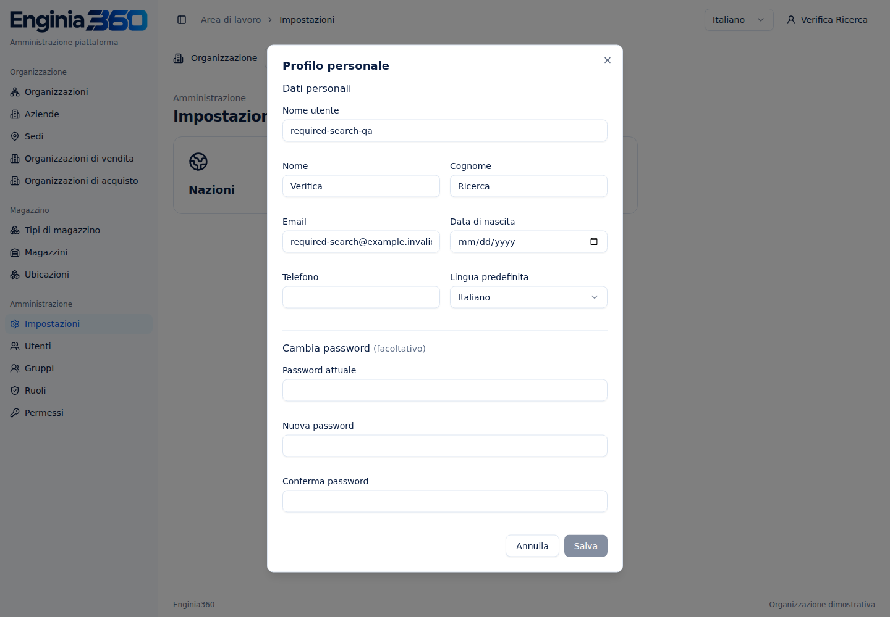

# Enginia360 — Guida rapida

Questa guida spiega accesso, anagrafiche, Business Partner e rapporti aziendali, Pagamenti, Catalogo articoli e servizi, tasse e imposte, magazzini, utenti, autorizzazioni e cataloghi geografici.

Le schermate sono reali e usano un'organizzazione dimostrativa. Le voci e i pulsanti disponibili dipendono dai tuoi permessi.

## 1. Accedere

1. Apri l'indirizzo di Enginia360 ricevuto dall'amministratore.
2. Inserisci **Codice organizzazione**, **Nome utente** e **Password**.
3. Premi **Accedi**.
4. Al primo accesso, se richiesto, scegli una nuova password e confermala.

Solo il Super Admin può accedere senza codice organizzazione. Il Super Admin può anche inserirlo per entrare con l'organizzazione già selezionata.

Se l'accesso non riesce, verifica i dati indicati nel messaggio. Per una password dimenticata o un'utenza disabilitata, contatta l'amministratore.

## 2. Orientarsi

- **Menu a sinistra:** apre le sezioni disponibili. Su uno schermo piccolo si apre dal pulsante del menu.
- **Organizzazione:** il Super Admin seleziona l'organizzazione su cui lavorare; la scelta resta selezionata al refresh nella stessa scheda del browser, anche quando sceglie nessuna organizzazione. Il ripristino verifica che l'organizzazione sia ancora disponibile. Il logout azzera la scelta; un nuovo accesso usa l'organizzazione indicata nel login. Gli utenti ordinari operano nella propria.
- **Lingua, in alto:** permette di passare tra italiano e inglese.
- **Profilo, in alto a destra:** apre i dati personali e il comando di uscita.

Negli elenchi puoi cercare, cambiare pagina e aprire una voce. **Nuovo** crea un record; l'icona della matita lo modifica. Il cestino richiede conferma prima di eliminare.

### Salvare senza sorprese

1. Compila i campi contrassegnati con **\***.
2. Nelle selezioni puoi digitare per trovare un'opzione, poi sceglierla.
3. Premi **Salva** per registrare dati e associazioni insieme.
4. Premi **Annulla** per chiudere senza registrare la bozza.

Digitare in una ricerca non salva nulla. Se Salva non è disponibile, controlla i campi obbligatori e gli eventuali errori. Il **Codice** delle anagrafiche è normalmente facoltativo; il codice dell'organizzazione è invece obbligatorio.

**Eccezione nelle tabelle correlate:** su un Business Partner già creato, la conferma di una riga o di un rapporto aziendale registra subito l'operazione. Annullare la scheda non annulla queste operazioni già confermate; vedi [Gestire i Business Partner](#8-gestire-i-business-partner).

## 3. Registrare aziende e sedi

Per iniziare, crea prima l'**Azienda**, poi le sue **Sedi**.

La scheda **Generale** dell'azienda non contiene identificativi fiscali. Il **Codice fiscale**, facoltativo, e le registrazioni IVA nazionali ed estere si gestiscono nella scheda **Fiscalità** dell'azienda, non sulle sedi. Per configurazione, registrazione iniziale e regimi segui [Fiscalità aziendale](#regimi-fiscali-e-fiscalità-aziendale): ogni nuova registrazione richiede un regime iniziale.

### Creare una sede

1. Apri **Sedi → Nuovo**.
2. Seleziona l'azienda e inserisci il nome della sede.
3. Inserisci la strada nel campo **Indirizzo**.
4. Scegli la **Nazione** e cerca la **Città**. Seleziona il suggerimento con il CAP corretto: città, provincia, CAP e regione vengono completati dai cataloghi locali. La strada digitata resta invariata.
5. Verifica **Indirizzo, Città, Provincia, CAP e Nazione**: sono tutti obbligatori. La Regione è facoltativa. Puoi completare manualmente i dati mancanti.
6. Scegli eventuali tipologia giuridica e funzioni, quindi premi **Salva**. Non sono richiesti né esposti identificativi fiscali della sede.

Uno stesso comune può avere più CAP: scegli quello appropriato alla sede. I suggerimenti aiutano la compilazione, ma i dati vanno sempre controllati.

### Organizzazioni commerciali

- **Organizzazioni di vendita:** appartengono a un'azienda.
- **Organizzazioni di acquisto:** possono coprire aziende e sedi. Seleziona prima le aziende, poi le sedi delle aziende selezionate.

Queste associazioni descrivono l'organizzazione commerciale: non concedono permessi agli utenti.

## 4. Organizzare i magazzini

Segui questo ordine:

1. **Tipi di magazzino:** crea le classificazioni necessarie.
2. **Magazzini:** crea il magazzino e collegalo a sede e tipo.
3. **Ubicazioni:** registra le posizioni interne e collegale al magazzino.

La foundation gestisce queste anagrafiche, non movimenti, giacenze o prenotazioni di merce.

## 5. Gestire utenti e autorizzazioni

Questa parte è riservata a chi possiede i permessi amministrativi.

- **Utenti:** persone che accedono all'organizzazione. Nome utente, nome, cognome ed email sono obbligatori.
- **Ruoli:** insiemi di permessi, per esempio quelli necessari a un operatore.
- **Gruppi:** raggruppano utenti e permettono di assegnare ruoli comuni.
- **Permessi:** catalogo consultabile delle operazioni disponibili; non si creano nuove voci manualmente.

### Configurare un ruolo

1. Apri **Ruoli → Nuovo** e inserisci il nome.
2. In **Permessi del ruolo**, apri i gruppi e seleziona le operazioni necessarie. I rami seguono i percorsi delle pagine: i permessi della numerazione BP si trovano in **Amministrazione → Impostazioni → Anagrafiche → Business Partner → Numerazione Business Partner**, non nelle Anagrafiche operative.
3. Usa la ricerca per trovare un permesso. Puoi selezionare un intero ramo o **Seleziona tutti**; una casella parziale indica che è selezionata solo una parte del ramo.
4. Premi **Salva**.
5. Assegna il ruolo agli utenti interessati, direttamente oppure attraverso un gruppo.

Concedi solo le operazioni necessarie. Un utente senza ruoli o permessi non ottiene automaticamente accesso alle funzioni dell'organizzazione, ma può sempre modificare il proprio profilo.

Per impostare o reimpostare la password di un altro utente, usa l'azione dedicata disponibile nella sezione **Utenti**. Comunica la password iniziale con un canale riservato: all'accesso sarà richiesto di sostituirla.

## 6. Consultare nazioni e città

Apri **Impostazioni → Sistema**, poi scegli la tile **Nazioni** o **Città**. La pagina Impostazioni raccoglie le funzioni disponibili: non contiene un elenco generico di impostazioni da creare o modificare.

I cataloghi sono condivisi da tutte le organizzazioni. Per consultarli serve il permesso di lettura del singolo catalogo assegnato dall’amministratore; solo il **Super Admin** può modificarli. Le unità di misura hanno permessi dedicati per consultazione, creazione e modifica.

- **Nazioni:** tutti i 249 paesi e territori ISO, con nome italiano e codice paese a due lettere, per esempio `IT`. Cerca per nome o codice ISO.
- **Città:** nazione, nome, CAP, provincia e regione. Più CAP dello stesso comune sono voci distinte.

Per aggiungere una città di una nuova nazione, registra prima la nazione. Una nazione collegata a città non può essere eliminata finché esistono quei collegamenti. Le modifiche ai cataloghi non riscrivono gli indirizzi già salvati nelle sedi.

Le tile Nazioni e Città si trovano nella pagina Sistema.

## 7. Aggiornare profilo e password

1. Premi il tuo nome in alto a destra e scegli **Profilo personale**.
2. Aggiorna nome, cognome, email, data di nascita, telefono o lingua preferita.
3. Premi **Salva**. Il nome utente non si modifica dal profilo.

Per cambiare anche la password, compila la password attuale, la nuova password e la conferma. La nuova password deve contenere da **14 a 256 caratteri**.

**Non serve cambiare la password per aggiornare i dati personali.** Lascia vuoti nuova password e conferma; un'eventuale password attuale inserita dal browser non obbliga a sostituirla.

Quando hai finito, apri il menu del profilo e scegli **Esci**.

## 8. Gestire i Business Partner

Il Business Partner identifica una persona o un'organizzazione una sola volta nell'organizzazione, senza duplicarla come cliente e fornitore. Nella stessa scheda si gestiscono i rapporti con le aziende e i ruoli commerciali Cliente/Fornitore.

Prima di creare un soggetto, cercalo per nome, codice o identificativo fiscale. Se esiste già, usa la stessa anagrafica e aggiungi il rapporto con l'altra azienda.

### Creare e attivare un soggetto

1. Apri **Anagrafiche → Business Partner → Nuovo Business Partner**.
2. Scegli **Organizzazione** o **Persona fisica** e inserisci ragione sociale oppure nome/cognome. Una persona in **Bozza** può avere solo nome o cognome; negli altri stati servono entrambi.
3. Aggiungi gli **Identificativi fiscali** disponibili, indicando nazione, tipo e valore. Per una partita IVA italiana inserisci le **11 cifre senza il prefisso IT**. Un identificativo già presente nello stesso ambito impedisce il salvataggio: cerca prima il soggetto esistente.
4. Aggiungi eventuali **Indirizzi**: strada, CAP, città e nazione sono obbligatori per ciascun indirizzo. Come nelle Sedi, digita almeno tre caratteri in città, CAP o provincia e scegli un suggerimento del catalogo locale: la selezione completa i dati geografici del solo indirizzo corrente, conservando strada e numero civico inseriti a mano. Puoi sempre compilare manualmente; la nazione usa lo stesso elenco del catalogo delle Sedi. Lo stesso indirizzo può essere usato per fatturazione, spedizione e altri utilizzi; puoi indicare un predefinito per ogni utilizzo.
5. Aggiungi eventuali **Contatti**, con tipo, valore e scopo. Puoi scegliere un principale per ogni tipo.
6. Scegli lo **Stato**: lascia **Bozza** per completare i dati in seguito oppure scegli **Attivo**. Compilare un identificativo fiscale non attiva automaticamente il soggetto.
7. Premi **Salva**: identità e righe del nuovo soggetto vengono registrate insieme. **Annulla** scarta le modifiche non salvate.

### Tabelle dei dati correlati

**Identificativi fiscali**, **Indirizzi** e **Contatti** sono presentati in tabelle compatte. Usa **Aggiungi** per una nuova riga, **Dettagli** per consultarla, **Modifica** per aggiornarla ed **Elimina** per rimuoverla dopo conferma. Gli utenti in sola lettura dispongono soltanto dei dettagli.

La finestra della riga mantiene tutti i campi, gli utilizzi degli indirizzi e l'autocompletamento geografico. Su un **Business Partner già salvato**, **Salva** nella finestra registra subito la riga; confermare **Rimuovi** registra subito l'eliminazione. Non occorre premere anche il Salva generale. Queste operazioni non salvano le modifiche pendenti ai dati principali e restano registrate anche chiudendo o annullando la scheda.

Su un **nuovo Business Partner**, **Applica** riporta la riga nella bozza: righe e identità vengono registrate insieme alla prima creazione con il Salva generale. **Annulla**, chiusura ed Esc della finestra scartano sempre le modifiche della riga non ancora confermate.

Un errore di validazione indica la riga e il campo interessati, spiega il controllo fallito e mostra il messaggio anche accanto al campo. Per esempio: **Identificativo fiscale 1 — Partita IVA: inserisci una partita IVA italiana di 11 cifre, senza il prefisso IT.** I dati inseriti rimangono nella scheda: correggi il campo e salva nuovamente.

Il codice viene assegnato automaticamente oppure inserito manualmente secondo la configurazione dell'organizzazione. Dopo il salvataggio non si modifica. Usa la ricerca anche per codice, identificativo fiscale o recapito.

Nella scheda **Fiscalità**, gli identificativi fiscali del soggetto restano distinti dai [profili fiscali del Business Partner](#fiscalità-di-articoli-e-business-partner). Un profilo assegna una classificazione per paese e periodo: non modifica la partita IVA e non verifica VIES o stabilimento della controparte.

Per conservare un soggetto non più utilizzato, aprilo e scegli **Archiviato** nello stato, poi salva: non esiste un cestino per i Business Partner. Il codice e gli identificativi fiscali restano riservati. Lo stato **Attivo** non certifica la completezza fiscale per future fatture.

Se un altro operatore ha modificato lo stesso soggetto, il sistema rifiuta la sovrascrittura: conserva i dati utili della tua bozza e riapri il soggetto per verificare la versione aggiornata.

### Aziende e ruoli commerciali

1. Apri un Business Partner già salvato e seleziona la tab **Aziende e ruoli**, separata da **Identità** e **Fiscalità**. Il cambio tab conserva le modifiche pendenti; al refresh viene ripristinata l'ultima tab autorizzata.
2. Premi **Associa azienda**, scegli un'azienda autorizzata e seleziona **Cliente**, **Fornitore**, entrambi o nessuno.
3. Conferma: il rapporto viene registrato subito, senza il Salva generale.
4. Usa la matita della riga per gestire i ruoli. Assegna un ruolo non ancora presente con la relativa casella o azione; per un ruolo già assegnato, usa l'azione distinta di blocco/attivazione.
5. Per sospendere tutto il rapporto con quella specifica azienda, blocca la relazione. Gli altri rapporti dello stesso BP restano invariati.

La tabella distingue **ruoli assegnati** e **ruoli utilizzabili**. Un ruolo è utilizzabile solo se l'organizzazione e l'azienda sono abilitate, il BP è Attivo, relazione e ruolo sono Attivi e l'operatore possiede il permesso d'uso per quell'azienda. Un ruolo bloccato rimane assegnato e può essere riattivato; non viene cancellato. Il blocco del solo Cliente non blocca il Fornitore.

Le operazioni confermate sui rapporti sono indipendenti dalle modifiche anagrafiche ancora in bozza e non vengono annullate chiudendo la scheda. Un BP nuovo deve essere creato prima di associarlo alle aziende.

### Bloccare, riattivare o archiviare

| Operazione | Effetto |
|---|---|
| Bloccare **Cliente** in un'azienda | Sospende solo quel ruolo; Fornitore e altre aziende restano indipendenti |
| Bloccare la **relazione** con un'azienda | Sospende entrambi i ruoli in quella sola azienda |
| Impostare il **Business Partner su Bloccato o Archiviato** | Impedisce l'utilizzo dei ruoli in tutte le aziende |
| Riattivare relazione o ruolo | Rimuove il blocco scelto; restano validi gli altri stati e i permessi necessari |

Usa l'azione di attivazione/blocco della riga e conferma. La riattivazione di una relazione non riattiva automaticamente un ruolo bloccato. I rapporti e i ruoli commerciali non si eliminano: vengono conservati per mantenere i collegamenti e lo storico. L'eliminazione di un identificativo fiscale, indirizzo o contatto è invece una distinta operazione della relativa tabella.

### Consultare i rapporti di tutte le aziende autorizzate

In **Anagrafiche → Business Partner**, scegli **Per azienda**. L'elenco iniziale mostra tutti i rapporti di tutte le aziende per cui disponi del permesso di lettura, con tutti i ruoli assegnati, inclusi quelli bloccati o non utilizzabili. La colonna **Azienda** distingue i rapporti dello stesso BP. Nessun filtro è attivo: **Tutte le aziende**, **Tutti i ruoli**, ricerca vuota e **Solo utilizzabili** disattivato. Puoi applicare i filtri facoltativi; scegli **Tutte le aziende** per rimuovere il filtro aziendale. L'azione Dettagli apre l'unica anagrafica condivisa.

Per esempio, Alfa Ricambi può comparire una volta per Service con Cliente e Fornitore, e una volta per Trading con il solo Fornitore. Non sono due anagrafiche: sono due rapporti dello stesso soggetto. **Solo utilizzabili** restringe la lista ai rapporti utilizzabili con i tuoi permessi; per cercare anche quelli bloccati lascialo disattivato.

### Autorizzare le aziende di un ruolo

Apri **Ruoli** e crea o modifica un ruolo. In **Aziende autorizzate**, seleziona le aziende; premi il **Salva** principale per registrare insieme dati del ruolo, aziende e permessi. Le selezioni restano in bozza fino al salvataggio; **Annulla** scarta tutte le modifiche non salvate. L’assegnazione aziende richiede il permesso dedicato, non il solo permesso di modifica del ruolo.

Assegna inoltre al ruolo i permessi necessari sotto **Anagrafiche → Business Partner → Aziende e ruoli**: lettura, associazione, modifica, utilizzo come cliente e/o fornitore. Il permesso e l'azienda devono provenire dallo stesso ruolo attivo. Esempio: un ruolo di modifica su Service e uno di sola lettura su Trading non consentono di modificare Trading. Vale anche per i ruoli ricevuti tramite gruppi.

Nessuna azienda selezionata significa nessun accesso ai rapporti aziendali, salvo il Super Admin globale. I ruoli esistenti non ricevono automaticamente i nuovi permessi o aziende. L'accesso all'anagrafica BP condivisa rimane distinto dall'accesso ai suoi rapporti aziendali. Listini, affidamenti, conti e codici locali cliente/fornitore non fanno parte di questa fase.

Per consultare i rapporti servono sia la lettura dell'anagrafica BP sia quella di **Aziende e ruoli** per le aziende interessate. Il permesso di utilizzo come Cliente o Fornitore non concede automaticamente associazione o modifica.

### Configurare la numerazione BP

Con i permessi dedicati, apri **Impostazioni**, poi le tile **Anagrafiche → Business Partner → Numerazione**. I pulsanti di ritorno e il percorso in alto permettono di risalire ai livelli precedenti. La pagina operativa Business Partner resta separata dalla configurazione.

- **Automatica:** imposta prefisso, numero minimo di cifre e prossimo numero; verifica l'anteprima, poi premi **Salva**. Il formato iniziale è `BP-000001`.
- **Manuale:** il codice viene inserito durante la creazione del soggetto.
- **Annulla:** ripristina i valori caricati senza scrivere.

La configurazione è condivisa dall'organizzazione, non distinta per azienda. Dopo il primo Business Partner non si possono cambiare modalità, formato o progressivo. Le numerazioni di fatture, ordini e altri documenti non fanno parte di questa schermata.

### Consultare e gestire le valute

Apri **Impostazioni → Sistema → Valute** per consultare il catalogo condiviso. Sono presenti codice alfabetico, codice numerico, nome, unità minori e stato. Solo il Super Admin globale può modificarlo; disabilitare una valuta la esclude dalle nuove scelte nell'anteprima pagamenti. Le unità minori indicano la precisione dell'importo: un valore non disponibile non viene sostituito automaticamente con due decimali.

La modifica si apre in una finestra. Se la valuta è cambiata nel frattempo, il salvataggio viene rifiutato: conserva le modifiche utili, riapri il record e confrontale con i dati aggiornati. Una bozza recuperata senza versione affidabile non può essere salvata: copia le modifiche, annulla e riapri.

Il catalogo è uno snapshot, non si aggiorna automaticamente. Include anche codici speciali e di test: verifica che quello scelto sia adatto all'uso. L'applicazione non effettua conversioni tra valute.

### Configurare i pagamenti

In **Anagrafiche → Pagamenti**, seleziona l'azienda e apri **Metodi di pagamento**, **Condizioni di pagamento** o **Impostazioni aziendali**. Metodi e condizioni sono specifici dell'azienda.

Metodi e condizioni sono elencati in tabelle con ricerca e si aprono in finestre di creazione, modifica o sola lettura. Nella finestra della condizione usa le schede **Generale** e **Rate**; l'anteprima scadenze è nella scheda Rate e le impostazioni aziendali sono invece nella pagina.

1. Crea un metodo con codice, descrizione, categoria e direzione: **Incassi**, **Pagamenti** o **Entrambi**. Il codice FatturaPA è facoltativo; il catalogo proposto è limitato. Puoi disattivare un metodo non più utilizzato.
2. Crea una condizione, scegli la data di riferimento e inserisci almeno una rata. Le percentuali devono totalizzare esattamente il 100%; per ciascuna rata imposta mesi, giorni, base e regola della data. Il metodo della condizione e quello della singola rata sono facoltativi.
3. Nell'**Anteprima scadenze**, inserisci importo, data e valuta abilitata con precisione disponibile e scegli **Calcola**. L'importo deve rispettare le unità minori della valuta. È una simulazione: non registra incassi o pagamenti.
4. In **Impostazioni aziendali** puoi scegliere separatamente condizione e metodo predefiniti per vendite e acquisti. I metodi devono essere compatibili rispettivamente con incassi e pagamenti.

Per un BP già salvato, nella sezione **Pagamenti predefiniti del partner** scegli un'azienda con rapporto utilizzabile e il ruolo **Cliente** o **Fornitore**, quindi condizione e metodo e premi **Salva**. I default sono distinti per azienda e ruolo; Cliente richiede metodi compatibili con incassi, Fornitore con pagamenti. Il salvataggio è separato da quello generale della scheda. I riferimenti disattivati non sono proposti per nuove scelte.

L'amministratore deve assegnare i permessi Pagamenti necessari e l'azienda **nello stesso ruolo attivo**. Per modificare impostazioni aziendali o default partner occorrono anche i permessi di lettura di metodi e condizioni; la simulazione richiede il permesso dedicato. I nuovi permessi non sono assegnati automaticamente ai ruoli esistenti. Se l'esito di un salvataggio è sconosciuto, ricarica e verifica prima di riprovare.

Al refresh nella stessa scheda, le bozze disponibili possono essere ripristinate dopo la verifica di organizzazione, azienda e permessi; non è una garanzia di recupero se l'archiviazione del browser non è disponibile o l'accesso è cambiato. Cambiare voce di menu può chiudere la finestra e scartare la bozza: copia prima i dati utili. Se un'altra modifica causa un conflitto, conserva i tuoi dati, riapri e confronta la versione aggiornata. Un esito sconosciuto può indicare che il salvataggio è già riuscito: il nuovo invio può restare bloccato, quindi verifica il record prima di procedere, senza ripetere alla cieca.

## 9. Configurare il Catalogo

L’identità di articoli e servizi è condivisa dalle aziende della stessa organizzazione: non creare duplicati per azienda. Le abilitazioni e le impostazioni operative sono invece distinte per azienda e si gestiscono nella scheda **Aziende** o nella vista **Per azienda**. Prezzi, giacenze e movimenti non fanno parte del Catalogo.

### Articoli e servizi

1. Apri **Anagrafiche → Catalogo → Articoli e servizi → Identità**. Cerca per nome, codice o identificativo; filtra per tipologia e stato. L’elenco iniziale mostra gli articoli **Attivi**; scegli **Tutti** per cercare anche sospesi e archiviati. Il tab **Per azienda** mostra le associazioni aziendali nella stessa schermata, secondo i permessi disponibili.
2. Premi **Nuovo** e inserisci nome, tipologia, categoria e unità base: sono obbligatori sia in creazione sia in modifica, anche nello stato **Sospeso**. Lo stato predefinito è **Attivo**; **Archiviato** non è disponibile sui nuovi articoli. Il marchio è facoltativo. Un'unità base come G è valida anche se la base generale della dimensione è KG. Gli articoli già presenti con dati incompleti restano consultabili, ma il Salva generale richiede di completarli.
3. In modalità automatica il codice viene assegnato al salvataggio. In modalità manuale usa soltanto lettere **A–Z/a–z** e cifre **0–9**, per un massimo di **40 caratteri**, senza spazi, accenti o simboli. Dopo la creazione puoi modificarlo soltanto se l'articolo è **Sospeso** e non è mai stato attivato. I codici precedenti non diventano disponibili per altri articoli.
4. Nelle schede **Identificativi** e **Unità** aggiungi i riferimenti e le confezioni. La scheda **Dati fisici** è disponibile soltanto per i beni; pesi e dimensioni sono facoltativi e riferiti all'unità base.
5. Premi **Salva** per registrare insieme articolo, stato e righe inserite. La conferma compare soltanto alla **prima attivazione**, perché rende immutabili codice e unità base. Se l'articolo è già stato attivato almeno una volta, l'avviso non compare più, nemmeno riattivandolo da **Sospeso**: i due campi restano bloccati. **Conferma e salva** registra i dati; **Annulla** conserva le modifiche nel form senza salvarle. Attivazione e riattivazione richiedono il relativo permesso; **Sospeso** non abilita l'utilizzo commerciale. La bozza locale recuperabile al refresh non è uno stato dell’articolo.

Gli identificativi GTIN vengono controllati per formato e cifra di controllo; gli stessi GTIN e barcode interni non possono identificare articoli diversi dell'organizzazione. Per ciascun tipo puoi indicare un identificativo principale. I riferimenti OEM/MPN possono essere condivisi. Scegli l'unità commerciale associata oppure lascia quella base; una confezione deve prima comparire nelle unità dell'articolo.

Per una confezione CF da 12 PZ imposta numeratore 12 e denominatore 1; per un altro articolo CF può avere un contenuto differente. Le alternative universali mantengono il rapporto già definito dalle unità. L'anteprima contestuale converte fra base e alternative attive dell'articolo senza registrare movimenti.

Su un articolo già salvato, confermare una riga di identificativi o unità registra subito quella riga, **senza salvare le modifiche dei dati generali**. Dati fisici e stato vengono invece registrati dal Salva generale. Sul nuovo articolo le righe restano locali fino al primo Salva. Prima di cambiare la base di un articolo sospeso mai attivato occorre non avere unità alternative, identificativi o dati fisici; dopo la prima attivazione la base e il codice restano bloccati.

La scheda **Fiscalità** gestisce i [profili fiscali dell'articolo](#fiscalità-di-articoli-e-business-partner), indipendenti dalle abilitazioni aziendali. Scegli classificazione e validità: la natura Bene/Servizio non assegna un'aliquota e non sostituisce una regola fiscale.

Per sospendere o riattivare un articolo, scegli **Sospeso** o **Attivo** nel campo **Stato**, poi premi **Salva**. Per archiviarlo scegli **Archiviato** e salva: prima dell'aggiornamento compare una conferma perché l'operazione è definitiva e l'articolo non potrà più essere riattivato. **Annulla** nella conferma non scrive nulla e conserva le modifiche del form. Un articolo archiviato rimane soltanto consultabile. Le transizioni richiedono permessi distinti; non vengono assegnati automaticamente.

### Marchi

Apri **Anagrafiche → Catalogo → Marchi**. Inserisci il nome; codice e descrizione sono facoltativi. Puoi disattivare un marchio senza eliminare i riferimenti già presenti negli articoli. Il marchio non identifica automaticamente il produttore o il fornitore.

### Categorie e tipologie

Apri **Anagrafiche → Catalogo → Categorie** oppure **Impostazioni → Anagrafiche → Catalogo → Tipologie articolo**. Usa la ricerca e le azioni della riga per consultare o modificare una voce; **Nuovo** apre la finestra di creazione.

- **Categorie:** inserisci il nome e scegli un'eventuale categoria padre. Codice e descrizione sono facoltativi. Modificare il padre sposta l'intero ramo; una categoria non può diventare figlia di sé stessa o dei propri discendenti. Si eliminano soltanto categorie prive di figli e collegamenti.
- **Tipologie articolo:** scegli la natura **Bene materiale**, **Bene immateriale**, **Servizio** oppure **Onere accessorio**, quindi i valori proposti per vendibilità e acquistabilità. Solo **Bene materiale** prevede gestione stock e dati fisici. Puoi modificare la natura finché la tipologia non è collegata ad alcun articolo o servizio, anche sospeso o archiviato; un collegamento aggiunto nel frattempo blocca il salvataggio del cambio natura. Le nuove organizzazioni dispongono inizialmente delle sole tipologie **Merce** e **Servizio**: crea esplicitamente le tipologie per le altre nature quando servono. Puoi aggiungerne altre o disattivare quelle non più utilizzate.

**Salva** registra la singola configurazione; **Annulla** scarta le modifiche non salvate. Le finestre si possono trascinare e ridimensionare.

Nelle **Tipologie articolo**, l'icona **Elimina** richiede il permesso dedicato. Se la tipologia è collegata ad articoli o servizi, anche sospesi o archiviati, compare un avviso e l'eliminazione è bloccata. In assenza di collegamenti viene chiesta conferma: **Annulla** non modifica nulla, **Elimina** rimuove la tipologia. Un collegamento aggiunto nel frattempo blocca comunque l'operazione. Il nuovo permesso non viene assegnato automaticamente ai ruoli.

### Unità di misura e conversioni

1. Apri **Impostazioni → Sistema → Unità di misura**.
2. Consulta le unità iniziali oppure premi **Nuovo**.
3. Inserisci nome, codice/simbolo obbligatorio, dimensione e precisione quantità da 0 a 12 decimali. Per le unità universali indica il fattore positivo verso la base; per l'unità base vale 1. Per confezioni come CF/PLT scegli la conversione specifica dell'articolo: non esiste un fattore globale.
4. Premi **Salva**. Ambito della conversione, dimensione, fattore e ruolo di base non sono più modificabili; per una definizione diversa crea una nuova unità.

Per ogni dimensione può esistere una sola base. Non puoi disattivarla finché altre unità attive della stessa dimensione la richiedono. Le unità si disattivano, non si eliminano.

L'azione **Converti** apre un'anteprima: scegli un'unità attiva della stessa dimensione, inserisci la quantità con il punto come separatore decimale e premi **Converti**. L'applicazione mostra risultato, anteprima prima dell'arrotondamento ed eventuale arrotondamento alla precisione dell'unità di destinazione. I valori a metà vengono arrotondati lontano da zero. L'anteprima non registra movimenti e non modifica la quantità inserita; non converte confezioni in pezzi.

Quantità e fattori accettano fino a 12 decimali e valori con magnitudine inferiore a `10000000000000000`; i fattori devono essere positivi. Nei rapporti periodici, l'anteprima prima dell'arrotondamento mostra al massimo 40 decimali: il risultato viene comunque calcolato dal rapporto esatto.

### Numerazione del Catalogo

Apri **Impostazioni → Anagrafiche → Catalogo → Numerazione**. La vista mostra le quattro nature: **Bene materiale**, **Bene immateriale**, **Servizio**, **Onere accessorio**. Puoi filtrare per natura oppure tornare a **Tutte le nature**. La ricerca filtra le configurazioni visualizzate. Modifica la configurazione desiderata con la matita.

- **Automatica:** scegli prefisso, numero minimo di cifre e prossimo progressivo. I formati iniziali sono `ART-000001`, `IMM-000001`, `SRV-000001` e `ONR-000001`, rispettivamente per le quattro nature. Le configurazioni già impostate restano invariate.
- **Manuale:** il codice viene inserito nell'anagrafica articolo.

Le quattro serie sono indipendenti fra loro e dalla numerazione Business Partner; il codice articolo deve comunque essere univoco nell'organizzazione, anche fra nature diverse. Dopo il primo utilizzo non si possono cambiare modalità, formato o riavvolgere il progressivo. Codice articolo, assegnazione e primo salvataggio vengono registrati insieme: un salvataggio rifiutato non consuma un numero.

### Lavorare con elenchi e finestre

La tabella **Identità** mostra codice, nome, tipologia, categoria, unità di misura base, marchio e stato; le azioni sono separate a destra. Puoi trascinare o ridimensionare le finestre. La lingua si cambia dal selettore italiano/inglese in alto.

### Bozze, conflitti e permessi

Al refresh nella stessa scheda il Catalogo recupera stato e bozze disponibili, verificando organizzazione, record e permessi attuali. Il recupero non sostituisce un salvataggio e dipende dallo storage del browser. Aprire nuovamente una voce dal menu resetta la relativa videata.

Una bozza basata su una versione superata resta protetta dalla sovrascrittura: confronta i dati, conserva le modifiche utili e riapri il record aggiornato. Se l'esito del salvataggio è incerto, usa la verifica dello stato prima di procedere; non ripetere alla cieca l'invio.

L'amministratore assegna separatamente consultazione, creazione, modifica e, per le categorie, eliminazione. Attivazione, disattivazione e archiviazione articolo hanno permessi dedicati. I permessi delle unità sono nel ramo **Impostazioni → Sistema → Unità di misura**, quelli di articoli, marchi e categorie in **Anagrafiche → Catalogo**, quelli delle tipologie in **Impostazioni → Anagrafiche → Catalogo → Tipologie articolo**, quelli della numerazione nel suo percorso impostazioni. Nessun nuovo permesso viene concesso automaticamente ai ruoli esistenti.

### Configurazioni aziendali degli articoli

I filtri sono compatti e partono sempre da **Cerca**. Quando non entrano sulla stessa riga, usa il pulsante con icona filtri in fondo alla riga per mostrare gli altri controlli. Chiudere il pannello non annulla i filtri già selezionati. Le tabelle allineano i testi a sinistra, i valori numerici/importi a destra e stati, icone e azioni al centro.

La creazione di un articolo non lo abilita automaticamente nelle aziende.

In **Abilita per aziende**, aziende e articoli sono mostrati in tabelle paginate. Gli articoli riportano gli stessi dati della lista Identità: codice, nome, tipologia, categoria, unità di misura base, marchio e stato, senza azioni di riga. La checkbox nell'intestazione seleziona o deseleziona le righe della pagina corrente; cambiare pagina o cercare un articolo non cancella le altre selezioni. Le aziende sono mostrate **25 per pagina**; ricerca e paginazione degli articoli interrogano il catalogo aggiornato. Per ogni azienda viene mostrato l’indirizzo della prima sede legale attiva censita: se manca, la cella resta vuota, senza usare l’indirizzo di una sede operativa. La finestra è ampia, trascinabile e ridimensionabile.

1. In **Anagrafiche → Catalogo → Articoli e servizi**, crea un articolo oppure aprine uno già salvato e scegli **Aziende**.
2. Premi **Abilita per un’azienda**, seleziona l'azienda e controlla vendibilità, acquistabilità e gestione scorte. I valori iniziali provengono dalla tipologia e restano indipendenti dopo il salvataggio.
3. Seleziona le unità predefinite di vendita/acquisto tra quelle ammesse oppure mantieni **Unità di misura base**.
4. In creazione, **Salva** nella finestra aziendale aggiorna soltanto la bozza: aggiungi, modifica o rimuovi le aziende, poi usa il **Salva generale** per registrare articolo e configurazioni insieme. Annullare la creazione non registra associazioni. Su un articolo già salvato, il salvataggio aziendale è invece immediato e non salva la bozza principale. La matita consente di modificare l'associazione; disabilitarla conserva le impostazioni.

Solo i beni materiali consentono la gestione scorte; questo flag non crea quantità o movimenti. La sospensione blocca l'utilizzo effettivo senza disabilitare le associazioni. L'archiviazione dell'articolo disabilita automaticamente tutte le associazioni aziendali, conservando le impostazioni operative e le unità predefinite; non possono essere riabilitate. Anche un'azienda disabilitata impedisce l'utilizzo effettivo e consente soltanto di disabilitare le associazioni esistenti.

Il tab **Per azienda** in **Anagrafiche → Catalogo → Articoli e servizi** mostra inizialmente le associazioni **Abilitate** delle aziende autorizzate. **Cerca** è il primo filtro a sinistra; seguono azienda, stato associazione e **Vendita consentita**, **Acquisto consentito**, **Scorte consentite**, ciascuno con scelta **Tutti/Sì/No**. Le tre colonne mostrano l'utilizzo effettivamente consentito: tick verde per sì, X rossa per no. Le impostazioni operative restano nel form di modifica. Seleziona **Tutte** o **Disabilitate** per consultare anche le associazioni escluse; tab e filtri restano al refresh, mentre il menu ripristina la vista iniziale autorizzata e **Abilitate**. **Abilita per aziende** consente la selezione esplicita di più articoli e aziende: massimo 100 per insieme e 500 associazioni. Le configurazioni già presenti, incluse quelle disabilitate, restano invariate.

Per abilitare più articoli insieme:

1. Apri **Per azienda** e premi **Abilita per aziende**.
2. Seleziona le aziende e gli articoli nelle due tabelle. La casella nell’intestazione riguarda solo la pagina visibile; controlla anche le selezioni conservate sulle altre pagine.
3. Rispetta i limiti di **100 articoli**, **100 aziende** e **500 coppie articolo–azienda**. I default della tipologia sono copiati solo nelle nuove associazioni; quelle esistenti non vengono sovrascritte o riabilitate.
4. Conferma il salvataggio. Un errore impedisce l’intera operazione; **Annulla** chiude senza registrarla. Aggiorna la lista per controllare il risultato, senza ripetere un invio dall’esito incerto.

L'amministratore assegna lettura, creazione e modifica del catalogo aziendale e le aziende autorizzate nello stesso ruolo. I pulsanti di scrittura richiedono anche la lettura della precisa azienda, necessaria alla verifica dell'esito; il catalogo aziendale può essere consultato senza accesso all'intero catalogo organizzativo o alla gestione anagrafica aziende. Nessun nuovo permesso è assegnato automaticamente. Dopo una risposta incerta usa **Leggi dati aggiornati** e conferma la verifica; refresh e menu non ripetono l'operazione.

## 10. Tasse e imposte

Apri **Impostazioni → Anagrafiche → Tasse e imposte**. Per il Super Admin seleziona prima l'organizzazione. Le schede **Codici imposta**, **Tipi di imposta** e **Nature IVA** dipendono dai permessi assegnati; tipologie e nature sono consultabili, non modificabili.

Nello stesso workspace trovi **Classificazioni articoli**, **Classificazioni Business Partner**, **Regimi fiscali**, **Regole fiscali** e **Simulatore fiscale**, ciascuno con permessi propri. Per modello e API: [riferimento tecnico TaxManagement](taxmanagement.md). La disponibilità di una scheda non concede scritture nelle altre; i nuovi permessi non vengono assegnati automaticamente ai ruoli.

**Creare un codice**

1. In **Codici imposta** premi **Nuovo** e inserisci nome, codice, nazione e tipologia. Il codice identifica il trattamento, non soltanto la percentuale.
2. Nella scheda delle versioni indica aliquota, trattamento e decorrenza; scegli la natura per i trattamenti italiani senza IVA esposta. `22` indica il 22%, non `0,22`.
3. Premi **Salva**. Identità e versioni iniziali vengono registrate insieme; **Annulla** non scrive.

**Programmare una variazione**

1. Apri un codice già salvato e la scheda **Versioni fiscali**.
2. Aggiungi la nuova configurazione con la relativa decorrenza e conferma. La versione precedente che contiene tale decorrenza viene chiusa al giorno prima, nella stessa operazione.
3. Controlla lo storico. Non modificare l'aliquota precedente per rappresentare una variazione; non sono ammessi intervalli sovrapposti.

Nome e descrizione si modificano nei dati generali. Disattivare impedisce nuovi utilizzi, ma conserva lo storico; riattivare richiede il relativo permesso. Le versioni registrate non si eliminano né si riscrivono. La scheda **Cronologia** mostra le operazioni del codice.

**Installare i codici italiani iniziali**

Usa l'azione di installazione dei codici italiani e scegli la decorrenza della configurazione. L'operazione aggiunge i codici mancanti, senza sovrascrivere quelli già personalizzati. Serve la nazione Italia nel catalogo e un permesso dedicato. I codici non vengono installati automaticamente nelle organizzazioni.

Il refresh conserva filtri e bozze nella stessa scheda; il menu resetta la schermata. Un conflitto richiede il confronto con i dati aggiornati. Se manca la risposta dopo un salvataggio, controlla prima l'esito autorevole: non ripetere alla cieca l'operazione.

### Classificazioni fiscali

Nello stesso percorso apri **Classificazioni articoli** oppure **Classificazioni Business Partner**. Sono elenchi configurabili dell'organizzazione, non un nomenclatore ufficiale e non aliquote IVA.

1. Premi **Nuovo** e indica nome, codice stabile, paese e tipo d'imposta. In questa fase è disponibile IVA.
2. Salva. Puoi correggere nome e descrizione; codice, paese e tipo restano immutabili. Per un significato diverso crea una nuova classificazione.
3. Disattiva le voci non più assegnabili. Gli abbinamenti già registrati restano nello storico; non si eliminano fisicamente.

L'installazione dei modelli iniziali è esplicita e aggiunge solo le voci mancanti per paese e tipo scelti, senza sovrascrivere le personalizzazioni. Non assegna automaticamente profili alle anagrafiche.

### Fiscalità di articoli e Business Partner

Apri il dettaglio dell'articolo oppure del Business Partner e la scheda **Fiscalità**.

1. Aggiungi un profilo indicando paese fiscale, tipo d'imposta, classificazione e decorrenza. La fine della validità è facoltativa.
2. Su una nuova anagrafica, conferma la riga e poi usa il **Salva** generale: padre e profili vengono registrati insieme. Prima di quel salvataggio le righe sono soltanto bozze.
3. Su un'anagrafica esistente, confermare il profilo lo registra subito e non salva le eventuali modifiche dei dati generali.
4. Per una variazione usa la programmazione: il profilo precedente che contiene la nuova decorrenza viene chiuso al giorno prima. Non sono ammessi intervalli sovrapposti nello stesso paese e tipo.

La data fiscale permette di consultare la classificazione valida in quel giorno. In assenza di profilo viene indicata esplicitamente la mancanza; non viene scelta una voce predefinita. Il paese fiscale non è necessariamente la residenza o lo stabilimento del partner. Natura articolo e partita IVA non determinano automaticamente classificazione o aliquota. Articoli e Business Partner possono essere creati senza profili; il profilo da solo non determina l'aliquota: occorrono anche configurazione aziendale, fatti e regole del simulatore.

Consultazione, assegnazione e programmazione del profilo hanno permessi distinti e richiedono anche la lettura dell'anagrafica. Il comando fiscale usa una propria versione: non salva le modifiche pendenti al soggetto. Disattivare una classificazione impedisce nuove assegnazioni ma conserva lo storico; gli intervalli registrati non si cancellano o riscrivono.

### Regimi fiscali e fiscalità aziendale

Il catalogo **Regimi fiscali**, in **Impostazioni → Anagrafiche → Tasse e imposte**, è consultabile ma non modificabile. Distingue regimi attivi e supportati; inizialmente è assegnabile il regime ordinario IVA per Italia, Germania e Francia. Il supporto applicativo parte dal **26 novembre 2026**: non indica l'introduzione del regime nella legislazione e non ricostruisce periodi anteriori.

1. Apri **Aziende**, quindi il dettaglio dell'azienda e la scheda **Fiscalità**. La tabella mostra una riga per configurazione, con tipo imposta, paese di stabilimento, codice fiscale e stato. In **Azioni** trovi **Attiva/Sospendi**, **Nuova registrazione** e **Mostra registrazioni**. Espandendo la riga consulti le registrazioni in una tabella di dettaglio, ciascuna con le proprie azioni uniformi. L'espansione resta al refresh ed è ripristinata per l'azienda corrente; il click sulla voce di menu resetta la vista ordinaria.
2. **Nuova configurazione** è disponibile solo per tipi di imposta supportati non ancora configurati, anche nelle bozze dell'azienda in creazione. Crea una configurazione IVA indicando esplicitamente il **Paese di stabilimento IVA**, l'eventuale **Codice fiscale**, la **Registrazione iniziale** e il **Regime iniziale**. Registrazione e regime sono obbligatori e vengono salvati insieme alla configurazione. Il paese di stabilimento resta immutabile e non viene ricavato dalle sedi; la configurazione nasce in **Bozza**.
3. Indica per la registrazione identificativo completo di prefisso maiuscolo, tipo e periodo. Il controllo è solo formale: non verifica assegnazione né VIES. I tipi disponibili dipendono dalla matrice supportata; la scelta non attesta requisiti o nomina di un rappresentante fiscale. Puoi aggiungere altre registrazioni dopo la creazione: **ciascuna richiede un regime iniziale**, salvato insieme alla registrazione. Non è presente una checkbox per escluderlo. Servono entrambi i permessi di registrazione e assegnazione del regime, nello stesso ruolo e ambito aziendale.
4. Il periodo del regime deve rientrare nella validità della registrazione e del regime stesso; non può sovrapporsi a un altro profilo della stessa registrazione. Il **Codice fiscale** delle configurazioni salvate è visualizzato in sola lettura nella scheda **Fiscalità**. Il modale si allarga in questa scheda per mostrare la tabella; sugli schermi piccoli resta disponibile lo scorrimento orizzontale.
5. Attiva la configurazione quando l'azienda è abilitata e almeno una registrazione con regime supportato è valida oggi, secondo la data UTC del server. La sospensione blocca nuovi utilizzi ma mantiene lo storico.
6. Per una variazione usa **Programma regime**; per cessare una posizione usa **Chiudi registrazione**. Le chiusure accorciano i periodi senza eliminare lo storico e rifiutano operazioni che renderebbero incoerenti profili futuri.

Sulle aziende esistenti le operazioni fiscali vengono salvate subito, senza salvare o scartare le bozze dei dati generali. Per creare un'azienda insieme alle configurazioni fiscali iniziali serve il Super Admin globale; gli altri utenti possono creare l'azienda senza dati fiscali e configurarla dopo l'assegnazione dell'ambito aziendale. Servono i permessi fiscali specifici e l'azienda autorizzata nello stesso ruolo, oltre alla lettura Aziende; non serve il permesso di modifica dei dati generali.

Nei nuovi moduli **Paese di stabilimento IVA** e **Paese fiscale** propongono **Italia**, modificabile prima del salvataggio. Il paese fiscale parte da Italia anche aggiungendo una registrazione a una configurazione estera; il tipo di registrazione proposto rispetta il paese di stabilimento. Le scelte già presenti nelle bozze non vengono sovrascritte.

Bozze e scheda selezionata vengono recuperate al refresh. Se l'esito di una richiesta è incerto, non ripeterla: usa **Rileggi dati fiscali** e conferma la verifica. Il reset da menu non elimina i comandi incerti. Registrazioni e regimi non determinano da soli aliquota, imponibilità o trattamento della transazione.

### Regole fiscali e simulatore

In **Impostazioni → Anagrafiche → Tasse e imposte**, apri **Regole fiscali** o **Simulatore fiscale**. Le due sezioni richiedono permessi distinti; l'aggiunta dei permessi al catalogo non li assegna automaticamente ai ruoli.

1. Crea una **Nuova regola** indicando paese, tipo imposta e ambito condiviso o aziendale. Il codice identifica stabilmente la regola. Aggiungi la prima versione in bozza, codice imposta, periodo, priorità e riferimento normativo. Il codice imposta viene risolto alla data dell'operazione: non copiare l'aliquota nella regola.
2. Costruisci le **Condizioni** con campi, operatori e valori proposti dal sistema. Sono combinate in AND. Per alternative usa regole separate; un dato sconosciuto non equivale a falso. La priorità numerica maggiore prevale, senza precedenza automatica per le regole aziendali.
3. **Valida** controlla riferimenti, condizioni e conflitti; **Pubblica** rende utilizzabile la bozza e ripete i controlli. La pubblicazione di un successore può chiudere il periodo della versione precedente. Le condizioni pubblicate non si modificano: crea una nuova versione. **Ritira** conserva lo storico e impedisce nuove determinazioni, anche retrodatate.
4. I template italiani si installano esplicitamente come sei bozze, senza sovrascrivere regole esistenti o creare automaticamente codici/classificazioni mancanti. Non sono una certificazione fiscale. I template con decorrenza nel 2026 terminano il 31 dicembre 2026; il passaggio al 2027 richiede una configurazione esplicita.
5. Nel **Simulatore fiscale** seleziona azienda, tipo imposta, data, registrazione aziendale, articolo e controparte. Dichiara i fatti dell'operazione e la loro provenienza: stabilimento della controparte, ruolo fiscale, territorialità ordinaria, eventuali trattamenti speciali e, per i beni, ubicazione, movimento e condizione doganale. Lascia sconosciuto ciò che non è accertato; partita IVA e classificazione non provano stabilimento o VIES.
6. Premi **Simula** per leggere esito, regola, versione del codice imposta, aliquota configurata e traccia. Le bozze entrano nella preview solo se selezionate esplicitamente. Il risultato non calcola importi né registra documenti. Un contesto incompleto, un conflitto o una casistica non supportata blocca la scelta: non viene applicata un'aliquota di ripiego.

Su una nuova regola, metadati e versioni iniziali restano locali fino al primo **Salva**. Su una regola già creata, salvare una versione in bozza è autonomo: non salva le modifiche pendenti a nome e descrizione. Il successo di **Salva** non pubblica la versione; dopo **Valida**, usa **Pubblica** e verifica il badge **Pubblicata**. La bozza salvata può essere simulata solo selezionandola esplicitamente; la preview sostituisce la pubblicata della stessa regola, non tutte le altre. Un errore di validazione o conflitto conserva la bozza da correggere e non certifica un esito fiscale.

Modificare gli input rende il risultato precedente non aggiornato. **Confronta due snapshot** confronta simulazioni salvate localmente, senza rideterminarle. Il refresh recupera form e risultati senza rieseguire la simulazione; il menu resetta la vista ordinaria. Per i salvataggi di esito incerto rileggi e verifica lo stato prima di procedere: nessun replay automatico. Il primo perimetro operativo comprende soltanto operazioni italiane nazionali ordinarie; transfrontaliere, esenzioni, reverse charge, split payment e regimi speciali restano esclusi.

### Calcolo fiscale multi-riga

Nel **Simulatore fiscale**, dopo una simulazione o determinazione riuscita, premi **Aggiungi al calcolo** nella scheda Risultato. Si apre **Calcolo documento** nello stesso simulatore: nessun nuovo menu. Ogni riga conserva il proprio scenario acquisito; modificarlo nel form iniziale non riscrive le righe già aggiunte.

1. Inserisci quantità e prezzo positivi e scegli **IVA esclusa** o **IVA inclusa**. Aggiungi altri scenari riusciti della stessa azienda e operazione. Sono ammesse al massimo 100 righe.
2. Aggiungi sconti o maggiorazioni di riga, percentuali o fissi. Le rettifiche si applicano nell'ordine mostrato: 10% seguito da 5% non equivale a 15%. Le frecce ne modificano la sequenza.
3. Le rettifiche di documento si ripartiscono sulle righe selezionate, oppure su tutte. Seleziona destinatari con la stessa base di prezzo, inclusa oppure esclusa; il sistema non interpreta automaticamente una rettifica mista come netta o lorda. Gli oneri comuni ordinari si inseriscono come maggiorazioni esplicite sulle operazioni principali; nessun onere del Catalogo viene aggiunto automaticamente.
4. Negli acquisti, lascia vuota **IVA detraibile (%)** quando la percentuale non è nota. Il valore inserito serve soltanto al calcolo matematico, non determina il diritto fiscale alla detrazione e non cambia il totale dovuto al fornitore. Gli importi attesi non modificano la fattura ricevuta.
5. Premi **Calcola · rivaluta il contesto fiscale**: il server acquisisce nuovamente le determinazioni correnti, una volta per riga, e restituisce imponibili, IVA, totali, riepiloghi e dettagli degli arrotondamenti. L'aliquota non è modificabile nella riga. La policy EUR è di sola lettura e richiede EUR abilitata con due decimali nel catalogo valute.
6. **Fissa confronto** conserva un risultato per il confronto locale. Le modifiche rendono il precedente risultato non aggiornato. Il refresh recupera dati e risultati senza rieseguire il calcolo; il click sul menu resetta la vista ordinaria.

Per aggiungere una seconda riga, torna al form del simulatore, imposta il nuovo articolo/partner e i fatti, esegui **Simula** e, solo con esito riuscito, premi nuovamente **Aggiungi al calcolo**. Le righe precedenti restano invariate. Se cambi azienda o operazione, non mescolare scenari: usa **Svuota righe documento** per iniziare un nuovo insieme. Togliere una riga rimuove anche quel destinatario dalle rettifiche comuni; verifica che ne resti almeno uno quando la selezione è esplicita.

Sono consentite fino a **20 rettifiche per riga** e **20 rettifiche di documento**. Le frecce su/giù cambiano la sequenza e quindi il risultato: prima si applicano quelle della riga, poi quelle comuni sulla base risultante. Usa il punto come separatore decimale. Quantità: fino a 6 decimali; prezzo: fino a 8; importi fissi: fino a 2; percentuali: fino a 6. Gli sconti e la detraibilità vanno da 0 a 100%; una rettifica non può consumare più della capienza disponibile. Un valore finale zero è ammesso dopo uno sconto valido.

Apri **Riepiloghi fiscali**, **Importi e ripartizioni per riga**, **Dettagli del calcolo** e **Dati acquisiti per il calcolo** per verificare gruppi fiscali, quote e correzioni di arrotondamento. I dettagli annidati si espandono a tutta la larghezza disponibile, anche nel confronto: non devi interpretarli come colonne monetarie della riga precedente. Negli importi inclusi il lordo commerciale viene conservato; righe, gruppi e totali riconciliano senza tolleranze a centesimi. Lasciare sconosciuta la detraibilità mostra un risultato non disponibile (`null`), non un'assunzione di 0% o 100%.

La schermata produce simulazioni, anche con bozze esplicitamente selezionate, e non registra documenti. **Storno** applica il segno negativo ai risultati di input positivi: non emette una nota di credito e non recupera le aliquote storiche di una fattura. Contesti incompleti, sconti oltre capienza e trattamenti non supportati bloccano il calcolo indicando riga, campo e verifiche fiscali pertinenti.

Servono lettura del simulatore e del calcolo, simulazione di entrambe le funzioni e lettura delle fonti, con gli ambiti aziendali previsti. I tre nuovi permessi di calcolo non vengono assegnati automaticamente ai ruoli; la sola lettura della policy non richiede il permesso della pagina Valute.

## 11. Risolvere i problemi più comuni

| Situazione | Cosa fare |
|---|---|
| Non riesco ad accedere | Controlla codice organizzazione, nome utente e password. Segui il messaggio mostrato; se necessario contatta l'amministratore. |
| Non vedo una sezione o il pulsante Nuovo | Verifica l'organizzazione selezionata e chiedi all'amministratore di controllare i permessi. |
| Salva è disabilitato | Completa i campi con \*, correggi gli errori e verifica di aver modificato almeno un dato. |
| Non trovo una città o una nazione | Cerca anche per CAP; chiedi al Super Admin di verificare o aggiungere la voce. L'indirizzo può essere completato manualmente. |
| Non posso eliminare una voce | Potrebbe essere ancora collegata ad altri record. Controlla i collegamenti prima di riprovare. |
| Il Business Partner resta in Bozza dopo l'inserimento della partita IVA | Scegli **Attivo** nello Stato e premi **Salva**: non esiste attivazione automatica. |
| Non vedo un'azienda o i suoi rapporti BP | Controlla i filtri e chiedi all'amministratore di verificare aziende autorizzate e permessi di lettura nello stesso ruolo. |
| Un ruolo assegnato non è utilizzabile | Verifica stato BP, relazione e ruolo; l'amministratore controlla anche organizzazione/azienda abilitate e permesso d'uso per quell'azienda. |
| Voglio eliminare un rapporto BP–azienda | I rapporti commerciali si bloccano e riattivano; non è prevista l'eliminazione. |
| La sessione è scaduta | Accedi di nuovo. Le modifiche non salvate non vengono registrate. |
