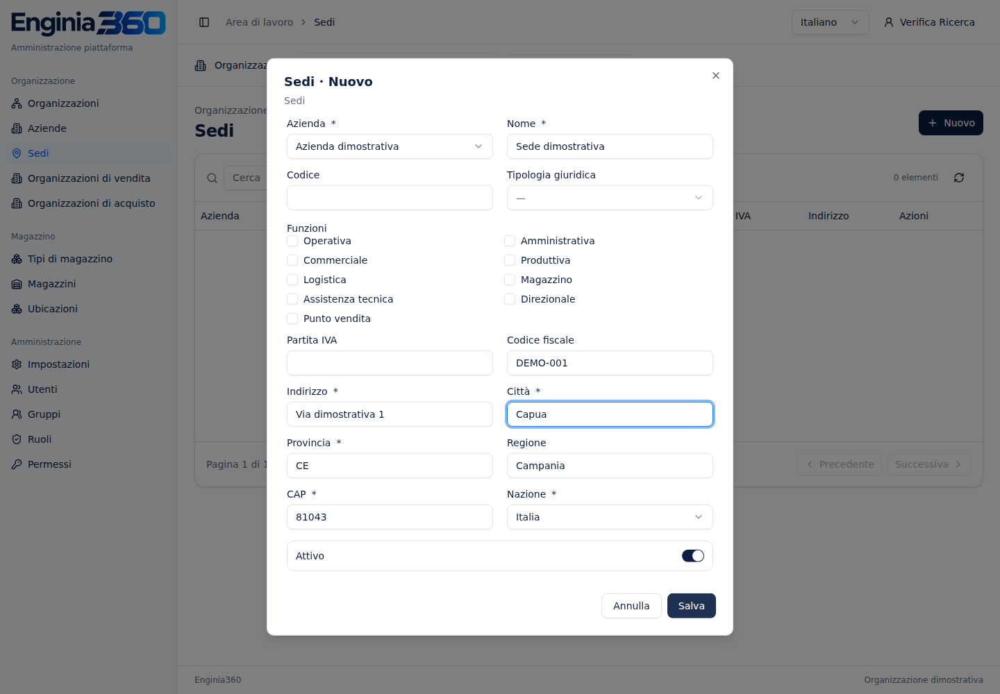

# Enginia360 — Guida rapida

Questa guida spiega le funzioni della foundation: accesso, anagrafiche, magazzini, utenti, autorizzazioni e cataloghi geografici.

Le schermate sono reali e usano un'organizzazione dimostrativa. Le voci e i pulsanti disponibili dipendono dai tuoi permessi.

## 1. Accedere

1. Apri l'indirizzo di Enginia360 ricevuto dall'amministratore.
2. Inserisci **Codice organizzazione**, **Nome utente** e **Password**.
3. Premi **Accedi**.
4. Al primo accesso, se richiesto, scegli una nuova password e confermala.

Solo il Super Admin può accedere senza codice organizzazione. Il Super Admin può anche inserirlo per entrare con l'organizzazione già selezionata.

Se l'accesso non riesce, verifica i dati indicati nel messaggio. Per una password dimenticata o un'utenza disabilitata, contatta l'amministratore.

## 2. Orientarsi

- **Menu a sinistra:** apre le sezioni disponibili. Su uno schermo piccolo si apre dal pulsante del menu.
- **Organizzazione:** il Super Admin seleziona l'organizzazione su cui lavorare; gli utenti ordinari operano nella propria.
- **Lingua, in alto:** permette di passare tra italiano e inglese.
- **Profilo, in alto a destra:** apre i dati personali e il comando di uscita.

Negli elenchi puoi cercare, cambiare pagina e aprire una voce. **Nuovo** crea un record; l'icona della matita lo modifica. Il cestino richiede conferma prima di eliminare.

### Salvare senza sorprese

1. Compila i campi contrassegnati con **\***.
2. Nelle selezioni puoi digitare per trovare un'opzione, poi sceglierla.
3. Premi **Salva** per registrare dati e associazioni insieme.
4. Premi **Annulla** per chiudere senza registrare la bozza.

Digitare in una ricerca non salva nulla. Se Salva non è disponibile, controlla i campi obbligatori e gli eventuali errori. Il **Codice** delle anagrafiche è normalmente facoltativo; il codice dell'organizzazione è invece obbligatorio.

## 3. Registrare aziende e sedi

Per iniziare, crea prima l'**Azienda**, poi le sue **Sedi**.

### Creare una sede

1. Apri **Sedi → Nuovo**.
2. Seleziona l'azienda e inserisci il nome della sede.
3. Compila almeno uno tra **Partita IVA** e **Codice fiscale**.
4. Inserisci la strada nel campo **Indirizzo**.
5. Scegli la **Nazione** e cerca la **Città**. Seleziona il suggerimento con il CAP corretto: città, provincia, CAP e regione vengono completati dai cataloghi locali. La strada digitata resta invariata.
6. Verifica **Indirizzo, Città, Provincia, CAP e Nazione**: sono tutti obbligatori. La Regione è facoltativa. Puoi completare manualmente i dati mancanti.
7. Scegli eventuali tipologia giuridica e funzioni, quindi premi **Salva**.

Uno stesso comune può avere più CAP: scegli quello appropriato alla sede. I suggerimenti aiutano la compilazione, ma i dati vanno sempre controllati.

### Organizzazioni commerciali

- **Organizzazioni di vendita:** appartengono a un'azienda.
- **Organizzazioni di acquisto:** possono coprire aziende e sedi. Seleziona prima le aziende, poi le sedi delle aziende selezionate.

Queste associazioni descrivono l'organizzazione commerciale: non concedono permessi agli utenti.

## 4. Organizzare i magazzini

Segui questo ordine:

1. **Tipi di magazzino:** crea le classificazioni necessarie.
2. **Magazzini:** crea il magazzino e collegalo a sede e tipo.
3. **Ubicazioni:** registra le posizioni interne e collegale al magazzino.

La foundation gestisce queste anagrafiche, non movimenti, giacenze o prenotazioni di merce.

## 5. Gestire utenti e autorizzazioni

Questa parte è riservata a chi possiede i permessi amministrativi.

- **Utenti:** persone che accedono all'organizzazione. Nome utente, nome, cognome ed email sono obbligatori.
- **Ruoli:** insiemi di permessi, per esempio quelli necessari a un operatore.
- **Gruppi:** raggruppano utenti e permettono di assegnare ruoli comuni.
- **Permessi:** catalogo consultabile delle operazioni disponibili; non si creano nuove voci manualmente.

### Configurare un ruolo

1. Apri **Ruoli → Nuovo** e inserisci il nome.
2. In **Permessi del ruolo**, apri i gruppi e seleziona le operazioni necessarie.
3. Usa la ricerca per trovare un permesso. Puoi selezionare un intero ramo o **Seleziona tutti**; una casella parziale indica che è selezionata solo una parte del ramo.
4. Premi **Salva**.
5. Assegna il ruolo agli utenti interessati, direttamente oppure attraverso un gruppo.

Concedi solo le operazioni necessarie. Un utente senza ruoli o permessi non ottiene automaticamente accesso alle funzioni dell'organizzazione, ma può sempre modificare il proprio profilo.

Per impostare o reimpostare la password di un altro utente, usa l'azione dedicata disponibile nella sezione **Utenti**. Comunica la password iniziale con un canale riservato: all'accesso sarà richiesto di sostituirla.

## 6. Consultare nazioni e città

Apri **Impostazioni**, poi scegli la tile **Nazioni** o **Città**.

I cataloghi sono condivisi da tutte le organizzazioni. Gli utenti autenticati possono consultarli; solo il **Super Admin** può modificarli.

- **Nazioni:** nome e codice paese a due lettere, per esempio `IT`.
- **Città:** nazione, nome, CAP, provincia e regione. Più CAP dello stesso comune sono voci distinte.

Per aggiungere una città di una nuova nazione, registra prima la nazione. Una nazione collegata a città non può essere eliminata finché esistono quei collegamenti. Le modifiche ai cataloghi non riscrivono gli indirizzi già salvati nelle sedi.

## 7. Aggiornare profilo e password

1. Premi il tuo nome in alto a destra e scegli **Profilo personale**.
2. Aggiorna nome, cognome, email, data di nascita, telefono o lingua preferita.
3. Premi **Salva**. Il nome utente non si modifica dal profilo.

Per cambiare anche la password, compila la password attuale, la nuova password e la conferma. La nuova password deve contenere da **14 a 256 caratteri**.

**Non serve cambiare la password per aggiornare i dati personali.** Lascia vuoti nuova password e conferma; un'eventuale password attuale inserita dal browser non obbliga a sostituirla.

Quando hai finito, apri il menu del profilo e scegli **Esci**.

## 8. Gestire i Business Partner

Il Business Partner identifica una persona o un'organizzazione una sola volta nell'organizzazione, senza duplicarla come cliente e fornitore. In questa fase si gestiscono soltanto i dati anagrafici, non i rapporti commerciali con le aziende.

1. Apri **Anagrafiche → Business Partner → Nuovo Business Partner**.
2. Scegli **Organizzazione** o **Persona fisica** e inserisci ragione sociale oppure nome/cognome. Una persona in **Bozza** può avere solo nome o cognome; negli altri stati servono entrambi.
3. Aggiungi gli **Identificativi fiscali** disponibili, indicando nazione, tipo e valore. Per una partita IVA italiana inserisci le **11 cifre senza il prefisso IT**. Un identificativo già presente nello stesso ambito impedisce il salvataggio: cerca prima il soggetto esistente.
4. Aggiungi eventuali **Indirizzi**: strada, CAP, città e nazione sono obbligatori per ciascun indirizzo. Lo stesso indirizzo può essere usato per fatturazione, spedizione e altri utilizzi; puoi indicare un predefinito per ogni utilizzo.
5. Aggiungi eventuali **Contatti**, con tipo, valore e scopo. Puoi scegliere un principale per ogni tipo.
6. Premi **Salva**: tutti i dati vengono registrati insieme. **Annulla** scarta le modifiche non salvate.

Un errore di validazione indica la riga e il campo interessati, spiega il controllo fallito e mostra il messaggio anche accanto al campo. Per esempio: **Identificativo fiscale 1 — Partita IVA: inserisci una partita IVA italiana di 11 cifre, senza il prefisso IT.** I dati inseriti rimangono nella scheda: correggi il campo e salva nuovamente.

Il codice viene assegnato automaticamente oppure inserito manualmente secondo la configurazione dell'organizzazione. Dopo il salvataggio non si modifica. Usa la ricerca anche per codice, identificativo fiscale o recapito.

Per conservare un soggetto non più utilizzato, aprilo e scegli **Archiviato** nello stato, poi salva: non esiste un cestino per i Business Partner. Il codice e gli identificativi fiscali restano riservati. Lo stato **Attivo** non certifica la completezza fiscale per future fatture.

Se un altro operatore ha modificato lo stesso soggetto, il sistema rifiuta la sovrascrittura: conserva i dati utili della tua bozza e riapri il soggetto per verificare la versione aggiornata.

### Configurare la numerazione BP

Con i permessi dedicati, apri **Impostazioni**, poi le tile **Anagrafiche → Business Partner → Numerazione**. I pulsanti di ritorno e il percorso in alto permettono di risalire ai livelli precedenti. La pagina operativa Business Partner resta separata dalla configurazione.

- **Automatica:** imposta prefisso, numero minimo di cifre e prossimo numero; verifica l'anteprima, poi premi **Salva**. Il formato iniziale è `BP-000001`.
- **Manuale:** il codice viene inserito durante la creazione del soggetto.
- **Annulla:** ripristina i valori caricati senza scrivere.

La configurazione è condivisa dall'organizzazione, non distinta per azienda. Dopo il primo Business Partner non si possono cambiare modalità, formato o progressivo. Le numerazioni di fatture, ordini e altri documenti non fanno parte di questa schermata.

## 9. Risolvere i problemi più comuni

| Situazione | Cosa fare |
|---|---|
| Non riesco ad accedere | Controlla codice organizzazione, nome utente e password. Segui il messaggio mostrato; se necessario contatta l'amministratore. |
| Non vedo una sezione o il pulsante Nuovo | Verifica l'organizzazione selezionata e chiedi all'amministratore di controllare i permessi. |
| Salva è disabilitato | Completa i campi con \*, correggi gli errori e verifica di aver modificato almeno un dato. |
| Non trovo una città o una nazione | Cerca anche per CAP; chiedi al Super Admin di verificare o aggiungere la voce. L'indirizzo può essere completato manualmente. |
| Non posso eliminare una voce | Potrebbe essere ancora collegata ad altri record. Controlla i collegamenti prima di riprovare. |
| La sessione è scaduta | Accedi di nuovo. Le modifiche non salvate non vengono registrate. |
